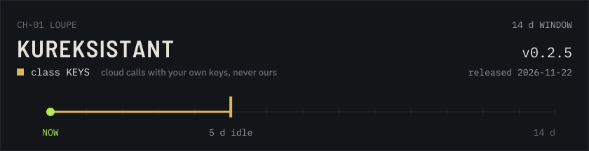

<!--
  Generated by scripts/build.mjs from data/apps.json, data/privacy.json, data/profile.json,
  the GitHub REST API, and the apps site. Do not edit by hand: change the registry.
  Every number on this page is generated. Anything unverifiable is UNKNOWN.
-->

<picture>
  <source media="(prefers-color-scheme: light)" srcset="assets/drum-light.svg">
  
</picture>

## Flagship: Kureksistant

<picture>
  <source media="(prefers-color-scheme: light)" srcset="assets/flagship-light.svg">
  
</picture>

A voice-first AI assistant daemon for Arch Linux and Hyprland. Summon it from anywhere, it answers with voice, deep-searches, and keeps its own notes.

[Repository](https://github.com/nodaysidle/kureksistant) · [App page](https://nodaysidle-apps.vercel.app/apps/kurek/)

## Release ledger

Every shipped app, newest release first. The gap is days since the last release, computed at build time; web apps count from their launch. Over 60 days reads as dormant, not deleted.

| App | Version | Released | Gap (days) | Platform | Demo |
| :--- | :--- | :--- | ---: | :--- | :--- |
| [NODAYSIDLE Browser for Linux](https://nodaysidle-apps.vercel.app/apps/browser-linux/) | [v0.4.0](https://github.com/nodaysidle/nodaysidle-browser-linux/releases/tag/v0.4.0) | 2026‑11‑25 | 3 | Linux | - |
| [Scratch Pad](https://nodaysidle-apps.vercel.app/apps/scratch-pad/) | [v0.2.2](https://github.com/nodaysidle/scratch-pad/releases/tag/v0.2.2) | 2026‑11‑24 | 4 | Linux | - |
| [Kureksistant](https://nodaysidle-apps.vercel.app/apps/kurek/) | [v0.2.5](https://github.com/nodaysidle/kureksistant/releases/tag/v0.2.5) | 2026‑11‑22 | 6 | Linux | - |
| [NeuralCanvas](https://nodaysidle-apps.vercel.app/apps/neuralcanvas/) | [v0.1.0](https://github.com/nodaysidle/neural-canvas/releases/tag/v0.1.0) | 2026‑10‑25 | 34 | Linux | - |
| [F1 Telemetry Pro](https://nodaysidle-apps.vercel.app/apps/f1-telemetry-pro/) | web | 2026‑10‑24 | 35 | Web | [LIVE](https://f1-telemetry-pro.vercel.app) |
| [VectorStudio](https://nodaysidle-apps.vercel.app/apps/vectorstudio/) | [v0.3.0](https://github.com/nodaysidle/no-vector-days/releases/tag/v0.3.0) | 2026‑10‑22 | 37 | Linux | - |
| [AI Rules Builder](https://nodaysidle-apps.vercel.app/apps/ai-rules-builder/) | web | 2026‑10‑21 | 38 | Web | [LIVE](https://markdown-helper.vercel.app) |
| [Sonora](https://nodaysidle-apps.vercel.app/apps/sonora/) | [v0.1.2](https://github.com/nodaysidle/nodaysidle-sonora/releases/tag/v0.1.2) | 2026‑10‑17 | 42 | Linux · macOS | - |
| [Cascade](https://nodaysidle-apps.vercel.app/apps/cascade/) | [v3.1.1](https://github.com/nodaysidle/nodaysidle-cascade-v3/releases/tag/v3.1.1) | 2026‑10‑17 | 42 | Linux · macOS | - |
| [nodaysrammar](https://nodaysidle-apps.vercel.app/apps/nodaysrammar/) | [v1.0.1](https://github.com/nodaysidle/nodaysrammar/releases/tag/v1.0.1) | 2026‑10‑09 | 50 | Chrome | - |
| [WhisperBar](https://nodaysidle-apps.vercel.app/apps/whisperbar/) · dormant | [v1.1.2](https://github.com/nodaysidle/whisper-bar/releases/tag/v1.1.2) | 2026‑09‑22 | 67 | macOS | - |

## What leaves your machine

Each app appears once, in the class its repository README states.

**LOCAL** stays on your machine (6) · **KEYS** cloud calls with your own keys (3) · **PUBLIC** public data only (2)

| Class | App | What it does | What leaves your machine |
| :--- | :--- | :--- | :--- |
| LOCAL | [NODAYSIDLE Browser for Linux](https://nodaysidle-apps.vercel.app/apps/browser-linux/) [Code](https://github.com/nodaysidle/nodaysidle-browser-linux) | A quiet, native Linux browser for focused browsing. | History and cookies stay local, with no application telemetry. The optional page assistant sends page data to TypeSafe Jev or Claude only when you click. |
| LOCAL | [Scratch Pad](https://nodaysidle-apps.vercel.app/apps/scratch-pad/) [Code](https://github.com/nodaysidle/scratch-pad) | One always-available note for Arch Linux and Hyprland, saved as you type. | Stays on your machine. No network access, no account, no telemetry. The note is stored locally. |
| LOCAL | [NeuralCanvas](https://nodaysidle-apps.vercel.app/apps/neuralcanvas/) [Code](https://github.com/nodaysidle/neural-canvas) | Sketch an interface by hand and get a clean wireframe, on a GPU canvas for Linux. | Stays on your machine. No network, no account. |
| LOCAL | [VectorStudio](https://nodaysidle-apps.vercel.app/apps/vectorstudio/) [Code](https://github.com/nodaysidle/no-vector-days) | A small desktop vector editor for Linux that keeps your work on your machine. | Stays on your machine. No network requests, no account. |
| LOCAL | [Sonora](https://nodaysidle-apps.vercel.app/apps/sonora/) [Code](https://github.com/nodaysidle/nodaysidle-sonora) | Universal native desktop music player for Spotify, YouTube Music, and local files. | Your library stays local, with no account or telemetry. Spotify, YouTube Music and LRCLIB connect directly from your machine. |
| LOCAL | [nodaysrammar](https://nodaysidle-apps.vercel.app/apps/nodaysrammar/) [Code](https://github.com/nodaysidle/nodaysrammar) | Private, on-device grammar and spell checker for English, Italian, and Slovenian. | Your text is checked on your device and never sent to a server. Preferences use Chrome Sync. |
| KEYS | [Kureksistant](https://nodaysidle-apps.vercel.app/apps/kurek/) [Code](https://github.com/nodaysidle/kureksistant) | A voice-first AI assistant daemon for Arch Linux and Hyprland. Summon it from anywhere, it answers with voice, deep-searches, and keeps its own notes. | Cloud-based, using your own keys. Voice goes to OpenRouter by default, requests to DeepSeek, spoken replies to xAI and screen captures to Gemini. Speech-to-text can fall back to local. |
| KEYS | [Cascade](https://nodaysidle-apps.vercel.app/apps/cascade/) [Code](https://github.com/nodaysidle/nodaysidle-cascade-v3) | Turn one software idea into five agent-ready markdown contracts. | Your idea goes to TypeSafe Jev and DeepSeek using your own keys, which stay in memory. No account, no telemetry. The rest runs locally. |
| KEYS | [WhisperBar](https://nodaysidle-apps.vercel.app/apps/whisperbar/) [Code](https://github.com/nodaysidle/whisper-bar) | Native, privacy-first macOS menu bar dictation with real-time streaming. | Your voice goes to Deepgram or OpenRouter, and refinement text to OpenRouter, using your own keys in the macOS Keychain. Transcript history stays local. |
| PUBLIC | [F1 Telemetry Pro](https://nodaysidle-apps.vercel.app/apps/f1-telemetry-pro/) [Code](https://github.com/nodaysidle/F1-nodaysidle) | Formula 1 telemetry analysis and session replay in the browser, on real OpenF1 timing data. | Runs in your browser and fetches public race data from OpenF1. No account, no tracking. |
| PUBLIC | [AI Rules Builder](https://nodaysidle-apps.vercel.app/apps/ai-rules-builder/) [Code](https://github.com/nodaysidle/markdown-helper) | Create, preview and share AGENTS.md and Cursor rules for AI coding agents. | Runs in your browser. Saved configs stay in localStorage, and share links carry the config in the URL. No account, no tracking. |

## How software is built here

[`01 IDEA`](contracts/IDEA.md) → [`02 PRD`](contracts/PRD.md) → [`03 ARD`](contracts/ARD.md) → [`04 TRD`](contracts/TRD.md) → [`05 TASKS`](contracts/TASKS.md) + [`AGENTS.md`](contracts/AGENTS.md)

One idea becomes five agent-ready contracts. Coding agents build from them. Nothing is called done until it runs live. [Cascade](https://github.com/nodaysidle/nodaysidle-cascade-v3) writes the contracts; the links above are the ones this page was built from.

## Repositories

All 71 public repositories: 63 own, 8 forks

| Repository | Language | Description |
| :--- | :--- | :--- |
| [audit-pull-request-target](https://github.com/nodaysidle/audit-pull-request-target) | - | Agent skill: find the GitHub Actions workflows the pull\_request\_target block will stop, and decide what to do with each |
| [batchrename-pro](https://github.com/nodaysidle/batchrename-pro) | Rust | Local-first desktop app for fast and safe batch file renaming. |
| [BrewLedger](https://github.com/nodaysidle/BrewLedger) | Swift | Native macOS brew log for tracking and reviewing coffee recipes. |
| [cliprail](https://github.com/nodaysidle/cliprail) | Swift | Local text-only clipboard history for the macOS menu bar. |
| [cursorpad](https://github.com/nodaysidle/cursorpad) | Swift | Native, ultra-fast macOS notepad with signature Cursor dark theme, sub-100ms launch, zero-latency TextKit 2 typing, and local atomic persistence. |
| [CutCap](https://github.com/nodaysidle/CutCap) | C++ | Local-first video editor for Arch Linux and Omarchy |
| [excalidays](https://github.com/nodaysidle/excalidays) | Swift | Local-first native macOS Excalidraw document app |
| [F1-nodaysidle](https://github.com/nodaysidle/F1-nodaysidle) | TypeScript | Client-side F1 telemetry analysis and session replay on real OpenF1 data: 4-driver lap overlays, track delta maps, lift &amp; coast detection, 60 FPS scrubbing. |
| [holdkey](https://github.com/nodaysidle/holdkey) | Rust | Global Wayland press/release &amp; push-to-talk broker over D-Bus for Hyprland, KDE, and GNOME. PipeWire mute &amp; AI voice dispatch. |
| [kurakami](https://github.com/nodaysidle/kurakami) | Python | Offline home karaoke machine for Omarchy / Hyprland |
| [kureksistant](https://github.com/nodaysidle/kureksistant) | Python | Autonomous, sub-second personal AI assistant daemon for Arch Linux \(Hyprland\) with Kurek Remote Android pairing. \~333MB RAM, Middle Click C-trigger, Muse Memory, TypeSafe Jev cognitive gating. |
| [levele](https://github.com/nodaysidle/levele) | TypeScript | Open-source, Canva-style design studio for the browser: templates, layers, animation, comments, live collaboration, and PNG/PDF/GIF/video export. |
| [levele-native](https://github.com/nodaysidle/levele-native) | C++ | Native C++17 / Qt Quick 6 layered design studio for Arch Linux and Omarchy |
| [markdown-helper](https://github.com/nodaysidle/markdown-helper) | TypeScript | Create and export AGENTS.md and Cursor rules for AI coding agents. Live demo on Vercel. |
| [monospace-notes](https://github.com/nodaysidle/monospace-notes) | Swift | A fast, dark, keyboard-first plain-text note editor for macOS: TextKit 2, atomic saves, a ⌘F search palette, zero dependencies. |
| [neural-canvas](https://github.com/nodaysidle/neural-canvas) | Rust | GPU-accelerated sketch-to-wireframe canvas for Linux: freehand sketches to clean wireframes, style mirroring, SVG/PDF/PNG export. Rust, wgpu, Wayland. |
| [no-vector-days](https://github.com/nodaysidle/no-vector-days) | JavaScript | Desktop vector editor for Linux: shapes, Bézier pen, layers, SVG and PNG export. Native Wayland AppImage. |
| [nodaysidian](https://github.com/nodaysidle/nodaysidian) | Swift | Native macOS knowledge graph for Markdown notes. |
| [nodaysidle](https://github.com/nodaysidle/nodaysidle) | JavaScript | Profile README and public project index for NODAYSIDLE. |
| [nodaysidle-apps](https://github.com/nodaysidle/nodaysidle-apps) | JavaScript | Download NODAYSIDLE apps: Cascade, Sonora, WhisperBar, Browser for Linux, and nodaysrammar \(Chrome\). |
| [nodaysidle-browser](https://github.com/nodaysidle/nodaysidle-browser) | Swift | Focused native macOS browser for quiet, distraction-light browsing. |
| [nodaysidle-browser-linux](https://github.com/nodaysidle/nodaysidle-browser-linux) | QML | Native Qt 6 browser for Omarchy: Chromium engine, pure Wayland, encrypted local password vault, import from other browsers, no telemetry. |
| [nodaysidle-cascade-v3](https://github.com/nodaysidle/nodaysidle-cascade-v3) | TypeScript | macOS app that turns one software idea into five agent-ready markdown contracts. |
| [nodaysidle-cascade-v4](https://github.com/nodaysidle/nodaysidle-cascade-v4) | TypeScript | Cascade V4: compile one software idea + locked preset into 5 agent-ready contracts &amp; starter kit, verified by a Claude Sonnet 5.5 review/repair/build loop. |
| [nodaysidle-cistilka](https://github.com/nodaysidle/nodaysidle-cistilka) | Swift | Native macOS disk space analyzer for finding large files and cleaning up safely. |
| [nodaysidle-cloudscribe](https://github.com/nodaysidle/nodaysidle-cloudscribe) | Swift | Cloud-only macOS dictation utility for fast speech-to-text capture. |
| [nodaysidle-echocore-pro](https://github.com/nodaysidle/nodaysidle-echocore-pro) | TypeScript | - |
| [nodaysidle-esm](https://github.com/nodaysidle/nodaysidle-esm) | JavaScript | Every Second Counts: a minimal black-and-white Chrome extension showing how much of your life is left, in real time. Offline and private. |
| [nodaysidle-everything](https://github.com/nodaysidle/nodaysidle-everything) | Rust | Craft Anything: study a website, app, game or file and rebuild it with your own coding agent, clean-room by default |
| [nodaysidle-flowstate](https://github.com/nodaysidle/nodaysidle-flowstate) | Swift | Adaptive macOS menu bar app for focus and work-state control. |
| [nodaysidle-lumiere](https://github.com/nodaysidle/nodaysidle-lumiere) | Swift | Native macOS app for screenshot cleanup, annotation, and visual polish. |
| [nodaysidle-ocr-agent](https://github.com/nodaysidle/nodaysidle-ocr-agent) | Rust | Fast Wayland Screen-Region OCR and Code Context Injector for AI coding agents and Herdr |
| [nodaysidle-project-pages](https://github.com/nodaysidle/nodaysidle-project-pages) | JavaScript | Public showcase site for NODAYSIDLE software releases and source projects. |
| [nodaysidle-shareguard](https://github.com/nodaysidle/nodaysidle-shareguard) | Swift | Local-first macOS privacy scanner for files before sharing. |
| [nodaysidle-sonora](https://github.com/nodaysidle/nodaysidle-sonora) | Rust | Universal native desktop music player uniting Spotify, YouTube Music, and Local files. Built with Tauri v2 + Rust + React 19. |
| [nodaysidle-voice-anywhere-v2](https://github.com/nodaysidle/nodaysidle-voice-anywhere-v2) | Kotlin | Android overlay dictation with system, local, and cloud speech input paths. |
| [nodaysidle-vois](https://github.com/nodaysidle/nodaysidle-vois) | Swift | Native hotkey-first dictation for macOS. |
| [nodaysrammar](https://github.com/nodaysidle/nodaysrammar) | JavaScript | On-device, zero-telemetry multilingual grammar and spell checker for Chromium \(Manifest V3\) |
| [nodaysrecording](https://github.com/nodaysidle/nodaysrecording) | Swift | Local-first macOS screen recorder for polished demos and tutorials. |
| [nodaystypst](https://github.com/nodaysidle/nodaystypst) | Swift | Predictive typing assistant for selected macOS text workflows. |
| [omarchy-theme-black-nodaysidle](https://github.com/nodaysidle/omarchy-theme-black-nodaysidle) | Shell | Strict BlackArch Linux hacker theme for Omarchy / Hyprland — pitch black, crimson laser accents, and sharp geometry. |
| [omarchy-theme-colinmcrae-tribute](https://github.com/nodaysidle/omarchy-theme-colinmcrae-tribute) | QML | - |
| [omarchy-theme-nodaysidle-carbon-noir](https://github.com/nodaysidle/omarchy-theme-nodaysidle-carbon-noir) | Lua | Haute brutalism and liquid titanium theme for Omarchy and Hyprland, tailored for 2560x1440 120Hz displays |
| [omarchy-theme-nodaysidle-compound](https://github.com/nodaysidle/omarchy-theme-nodaysidle-compound) | Python | F1 pit wall telemetry and tyre compound theme for Omarchy and Hyprland, tailored for 2560x1440 165Hz displays |
| [omarchy-theme-nodaysidle-halide](https://github.com/nodaysidle/omarchy-theme-nodaysidle-halide) | Shell | Photographic darkroom instrument panel theme for Omarchy / Hyprland — neutral cold greys, hard 1px silver rules, and a single chartreuse safelight signal. |
| [omarchy-theme-nodaysidle-kiln](https://github.com/nodaysidle/omarchy-theme-nodaysidle-kiln) | Shell | Fired-clay dark Omarchy theme with glowing ember rail and bone typography |
| [omarchy-theme-nodaysidle-machina](https://github.com/nodaysidle/omarchy-theme-nodaysidle-machina) | Shell | Industrial titanium and liquid mercury Omarchy theme for nodaysidle |
| [omarchy-theme-nodaysidle-monolith](https://github.com/nodaysidle/omarchy-theme-nodaysidle-monolith) | Shell | Brutalist stealth monochrome and bone chalk Omarchy theme for nodaysidle |
| [omarchy-theme-nodaysidle-royal-green](https://github.com/nodaysidle/omarchy-theme-nodaysidle-royal-green) | Lua | Haute horology and British racing atelier theme for Omarchy and Hyprland, tailored for 2560x1440 120Hz displays |
| [omarchy-theme-nodaysidle-royal-red](https://github.com/nodaysidle/omarchy-theme-nodaysidle-royal-red) | Lua | F1 pit wall telemetry and Scuderia monogram theme for Omarchy and Hyprland, tailored for 2560x1440 120Hz displays |
| [omarchy-theme-nodaysidle-tide](https://github.com/nodaysidle/omarchy-theme-nodaysidle-tide) | Python | Calm deep-water decompression theme for Omarchy / Hyprland |
| [omarchy-theme-nodaysidle-voidline](https://github.com/nodaysidle/omarchy-theme-nodaysidle-voidline) | Shell | True pitch OLED void and electric laser telemetry Omarchy theme for nodaysidle |
| [openidle](https://github.com/nodaysidle/openidle) | TypeScript | - |
| [pocket-drafts](https://github.com/nodaysidle/pocket-drafts) | Swift | Native macOS menu bar app for fast, private note capture. |
| [Portfolio](https://github.com/nodaysidle/Portfolio) | JavaScript | Editorial static portfolio—build-time HTML, real GitHub artwork, Vercel deploy. |
| [reverseuno](https://github.com/nodaysidle/reverseuno) | Kotlin | Push-to-talk dictation for Omarchy / Hyprland. Hold Right Super, speak, release; the text lands at your cursor. |
| [scratch-pad](https://github.com/nodaysidle/scratch-pad) | TypeScript | One always-available note for Arch Linux and Hyprland: Tauri 2, follows the Omarchy theme and terminal font live, autosaves, no network. |
| [scribeflowpro](https://github.com/nodaysidle/scribeflowpro) | Swift | Native macOS speech-to-text transcription app. |
| [skill-gallery](https://github.com/nodaysidle/skill-gallery) | JavaScript | Static gallery of 119 awesome-llm-apps agent templates. Zero build step. |
| [small-count](https://github.com/nodaysidle/small-count) | Swift | Private local-only tally counter for the macOS menu bar. |
| [synapse-notes](https://github.com/nodaysidle/synapse-notes) | TypeScript | Voice-first notes with transcription, semantic search, and visual knowledge exploration. |
| [tur-n-ing](https://github.com/nodaysidle/tur-n-ing) | Kotlin | - |
| [whisper-bar](https://github.com/nodaysidle/whisper-bar) | Swift | Native, privacy-first macOS menu bar dictation with Deepgram streaming, OpenRouter refinement, and zero dependencies. |

Forks: [awesome-ai-devtools](https://github.com/nodaysidle/awesome-ai-devtools) · [awesome-cursorrules](https://github.com/nodaysidle/awesome-cursorrules) · [Awesome-Design-Tools](https://github.com/nodaysidle/Awesome-Design-Tools) · [awesome-spec-driven-development](https://github.com/nodaysidle/awesome-spec-driven-development) · [awesome-vibe-coding](https://github.com/nodaysidle/awesome-vibe-coding) · [awesome-wgpu](https://github.com/nodaysidle/awesome-wgpu) · [hermes-agent](https://github.com/nodaysidle/hermes-agent) · [hermes-gpt](https://github.com/nodaysidle/hermes-gpt)

---

[nodaysidle-apps.vercel.app](https://nodaysidle-apps.vercel.app) · [GitHub](https://github.com/nodaysidle) · [nodaysidle@tutanota.de](mailto:nodaysidle@tutanota.de) · rebuilt daily by CI · last build 2026-11-28
