<!--
  Generated by scripts/build.mjs from data/profile.json, data/privacy.json, and the apps on
  https://nodaysidle-apps.vercel.app.
-->

<a href="https://f1-telemetry-pro.vercel.app"></a>
<a href="https://f1-telemetry-pro.vercel.app">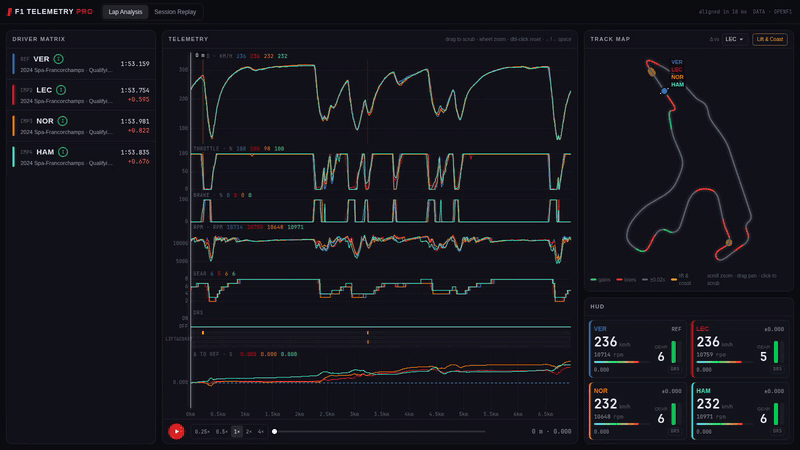</a>

**Running above: F1 Telemetry Pro.** [Open the replay in your browser](https://f1-telemetry-pro.vercel.app)

<a href="https://nodaysidle-apps.vercel.app/apps/neuralcanvas/">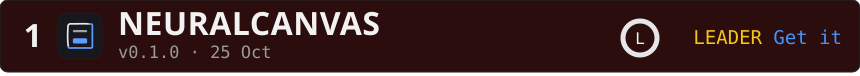</a>
<a href="https://f1-telemetry-pro.vercel.app">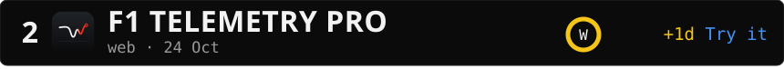</a>
<a href="https://nodaysidle-apps.vercel.app/apps/vectorstudio/">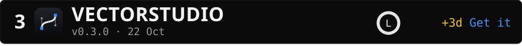</a>
<a href="https://markdown-helper.vercel.app">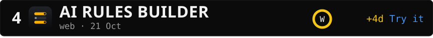</a>
<a href="https://nodaysidle-apps.vercel.app/apps/cascade/">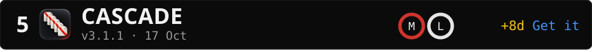</a>
<a href="https://nodaysidle-apps.vercel.app/apps/sonora/">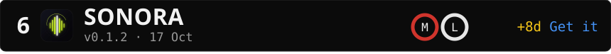</a>
<a href="https://nodaysidle-apps.vercel.app/apps/browser-linux/">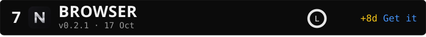</a>
<a href="https://nodaysidle-apps.vercel.app/apps/kurek/">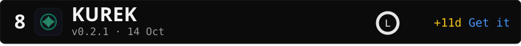</a>
<a href="https://nodaysidle-apps.vercel.app/apps/nodaysrammar/">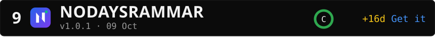</a>
<a href="https://nodaysidle-apps.vercel.app/apps/whisperbar/">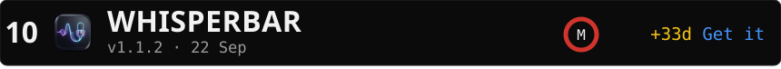</a>

W web · L Linux · M macOS · C Chrome · Gap is days behind the newest release

**Try one now:** [F1 Telemetry Pro](https://f1-telemetry-pro.vercel.app) · [AI Rules Builder](https://markdown-helper.vercel.app) · [Prompt Optimizer](https://nodaysidle-prompt-optimizer.vercel.app)

### Ten apps between 22 Sep and 25 Oct

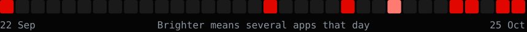

### How an app gets built

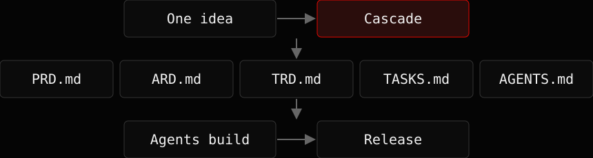

[Cascade](https://github.com/nodaysidle/nodaysidle-cascade-v3) turns one idea into five contracts that a coding agent can build from.

### What each app does, and what leaves your machine

Some apps need a cloud service to work. This table says which ones, and what they send.

| App | What it does | Privacy |
| :--- | :--- | :--- |
| [NeuralCanvas](https://nodaysidle-apps.vercel.app/apps/neuralcanvas/) · [Code](https://github.com/nodaysidle/neural-canvas) | Sketch an interface by hand and get a clean wireframe, on a GPU canvas for Linux. | Stays on your machine. No network, no account. |
| [F1 Telemetry Pro](https://nodaysidle-apps.vercel.app/apps/f1-telemetry-pro/) · [Code](https://github.com/nodaysidle/F1-nodaysidle) | Formula 1 telemetry analysis and session replay in the browser, on real OpenF1 timing data. | Runs in your browser and fetches public race data from OpenF1. No account, no tracking. |
| [VectorStudio](https://nodaysidle-apps.vercel.app/apps/vectorstudio/) · [Code](https://github.com/nodaysidle/no-vector-days) | A small desktop vector editor for Linux that keeps your work on your machine. | Stays on your machine. No network requests, no account. |
| [AI Rules Builder](https://nodaysidle-apps.vercel.app/apps/ai-rules-builder/) · [Code](https://github.com/nodaysidle/markdown-helper) | Create, preview and share AGENTS.md and Cursor rules for AI coding agents. | Runs in your browser. Saved configs stay in localStorage, and share links carry the config in the URL. No account, no tracking. |
| [Cascade](https://nodaysidle-apps.vercel.app/apps/cascade/) · [Code](https://github.com/nodaysidle/nodaysidle-cascade-v3) | Turn one software idea into five agent-ready markdown contracts. | Your idea goes to TypeSafe Jev and DeepSeek using your own keys, which stay in memory. No account, no telemetry. The rest runs locally. |
| [Sonora](https://nodaysidle-apps.vercel.app/apps/sonora/) · [Code](https://github.com/nodaysidle/nodaysidle-sonora) | Universal native desktop music player for Spotify, YouTube Music, and local files. | Your library stays local, with no account or telemetry. Spotify, YouTube Music and LRCLIB connect directly from your machine. |
| [NODAYSIDLE Browser for Linux](https://nodaysidle-apps.vercel.app/apps/browser-linux/) · [Code](https://github.com/nodaysidle/nodaysidle-browser-linux) | A quiet, native Linux browser for focused browsing. | History and cookies stay local, with no application telemetry. The optional page assistant sends page data to TypeSafe Jev or Claude only when you click. |
| [Kurek](https://nodaysidle-apps.vercel.app/apps/kurek/) · [Code](https://github.com/nodaysidle/kureksistant) | A voice assistant daemon for Arch and Hyprland. | Cloud-based, using your own keys. Voice goes to OpenRouter by default, requests to DeepSeek, spoken replies to xAI and screen captures to Gemini. Speech-to-text can fall back to local. |
| [nodaysrammar](https://nodaysidle-apps.vercel.app/apps/nodaysrammar/) · [Code](https://github.com/nodaysidle/nodaysrammar) | Private, on-device grammar and spell checker for English, Italian, and Slovenian. | Your text is checked on your device and never sent to a server. Preferences use Chrome Sync. |
| [WhisperBar](https://nodaysidle-apps.vercel.app/apps/whisperbar/) · [Code](https://github.com/nodaysidle/whisper-bar) | Native, privacy-first macOS menu bar dictation with real-time streaming. | Your voice goes to Deepgram or OpenRouter, and refinement text to OpenRouter, using your own keys in the macOS Keychain. Transcript history stays local. |

<code>nodaysidle-apps.vercel.app</code> · <a href="https://github.com/nodaysidle">GitHub</a> · <a href="mailto:nodaysidle@tutanota.de">nodaysidle@tutanota.de</a>
