<!--
  Generated by scripts/build.mjs from data/profile.json and the apps on
  https://nodaysidle-apps.vercel.app. Do not edit by hand: change the site's data/apps.json.
-->

<a href="https://nodaysidle-apps.vercel.app"></a>

<a href="https://nodaysidle-apps.vercel.app/apps/f1-telemetry-pro/">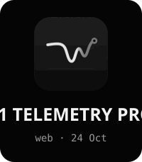</a>
<a href="https://nodaysidle-apps.vercel.app/apps/neuralcanvas/">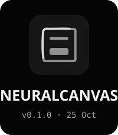</a>
<a href="https://nodaysidle-apps.vercel.app/apps/vectorstudio/">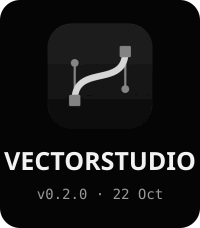</a>
<a href="https://nodaysidle-apps.vercel.app/apps/ai-rules-builder/">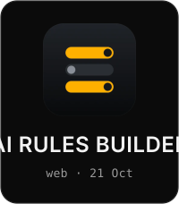</a>
<a href="https://nodaysidle-apps.vercel.app/apps/cascade/">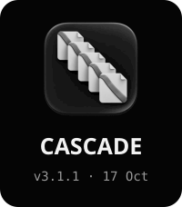</a>
<a href="https://nodaysidle-apps.vercel.app/apps/sonora/">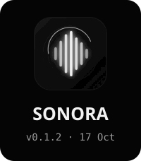</a>
<a href="https://nodaysidle-apps.vercel.app/apps/browser-linux/">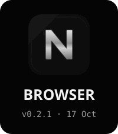</a>
<a href="https://nodaysidle-apps.vercel.app/apps/kurek/">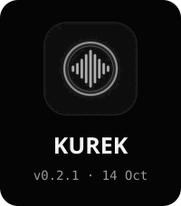</a>
<a href="https://nodaysidle-apps.vercel.app/apps/nodaysrammar/">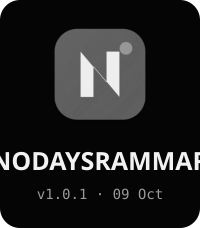</a>
<a href="https://nodaysidle-apps.vercel.app/apps/whisperbar/">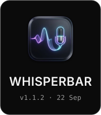</a>

| App | What it does | Runs on | |
|---|---|---|---|
| **F1 Telemetry Pro** | Formula 1 telemetry analysis and session replay in the browser, on real OpenF1 timing data. | Web | [Get it](https://nodaysidle-apps.vercel.app/apps/f1-telemetry-pro/) · [Source](https://github.com/nodaysidle/F1-nodaysidle) |
| **NeuralCanvas** | Sketch an interface by hand and get a clean wireframe, on a GPU canvas for Linux. | Linux | [Get it](https://nodaysidle-apps.vercel.app/apps/neuralcanvas/) · [Source](https://github.com/nodaysidle/neural-canvas) |
| **VectorStudio** | A small desktop vector editor for Linux that keeps your work on your machine. | Linux | [Get it](https://nodaysidle-apps.vercel.app/apps/vectorstudio/) · [Source](https://github.com/nodaysidle/no-vector-days) |
| **AI Rules Builder** | Create, preview and share AGENTS.md and Cursor rules for AI coding agents. | Web | [Get it](https://nodaysidle-apps.vercel.app/apps/ai-rules-builder/) · [Source](https://github.com/nodaysidle/markdown-helper) |
| **Cascade** | Turn one software idea into five agent-ready markdown contracts. | macOS · Linux | [Get it](https://nodaysidle-apps.vercel.app/apps/cascade/) · [Source](https://github.com/nodaysidle/nodaysidle-cascade-v3) |
| **Sonora** | Universal native desktop music player for Spotify, YouTube Music, and local files. | macOS · Linux | [Get it](https://nodaysidle-apps.vercel.app/apps/sonora/) · [Source](https://github.com/nodaysidle/nodaysidle-sonora) |
| **NODAYSIDLE Browser for Linux** | A quiet, native Linux browser for focused browsing. | Linux | [Get it](https://nodaysidle-apps.vercel.app/apps/browser-linux/) · [Source](https://github.com/nodaysidle/nodaysidle-browser-linux) |
| **Kurek** | A voice assistant daemon for Arch and Hyprland. | Linux | [Get it](https://nodaysidle-apps.vercel.app/apps/kurek/) · [Source](https://github.com/nodaysidle/kureksistant) |
| **nodaysrammar** | Private, on-device grammar and spell checker for English, Italian, and Slovenian. | Chrome | [Get it](https://nodaysidle-apps.vercel.app/apps/nodaysrammar/) · [Source](https://github.com/nodaysidle/nodaysrammar) |
| **WhisperBar** | Native, privacy-first macOS menu bar dictation with real-time streaming. | macOS | [Get it](https://nodaysidle-apps.vercel.app/apps/whisperbar/) · [Source](https://github.com/nodaysidle/whisper-bar) |

<code>nodaysidle-apps.vercel.app</code> · <a href="https://github.com/nodaysidle">GitHub</a> · <a href="mailto:nodaysidle@tutanota.de">nodaysidle@tutanota.de</a>
