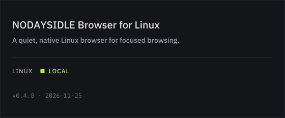
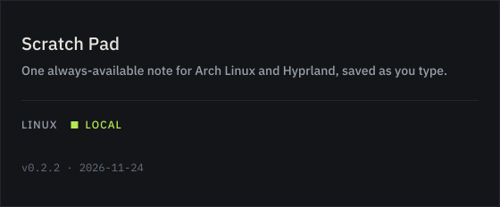
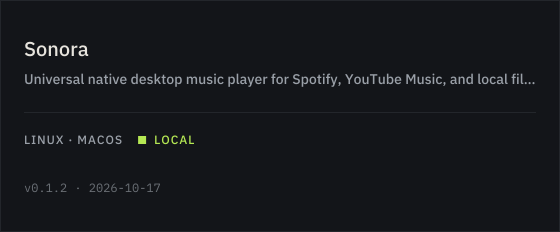
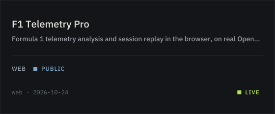
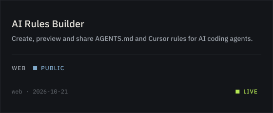
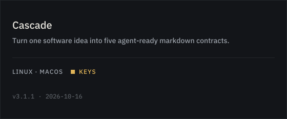
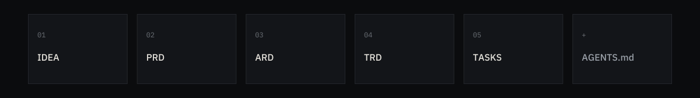

<!--
  Generated by scripts/build.mjs from data/apps.json, data/privacy.json, data/profile.json,
  the GitHub REST API, and the apps site. Do not edit by hand: change the registry.
  Every number on this page is generated. Anything unverifiable is UNKNOWN.
-->

## Kureksistant

A voice-first AI assistant daemon for Arch Linux and Hyprland. Summon it from anywhere, it answers with voice, deep-searches, and keeps its own notes. [Repository](https://github.com/nodaysidle/kureksistant) · [App page](https://nodaysidle-apps.vercel.app/apps/kurek/)

## Release ledger

Every shipped app, one row, sorted by the newest release. The gap is days since the
last release, computed at build time; web apps count from their launch. A gap over
60 days reads as dormant, not deleted.

| App | Version | Released | Gap (days) | Platform | Demo | Class |
| --- | --- | --- | --- | --- | --- | --- |
| [NODAYSIDLE Browser for Linux](https://nodaysidle-apps.vercel.app/apps/browser-linux/) | [v0.4.0](https://github.com/nodaysidle/nodaysidle-browser-linux/releases/tag/v0.4.0) | 2026-11-25 | 3 | Linux | - | LOCAL |
| [Scratch Pad](https://nodaysidle-apps.vercel.app/apps/scratch-pad/) | [v0.2.2](https://github.com/nodaysidle/scratch-pad/releases/tag/v0.2.2) | 2026-11-24 | 4 | Linux | - | LOCAL |
| [Kureksistant](https://nodaysidle-apps.vercel.app/apps/kurek/) | [v0.2.5](https://github.com/nodaysidle/kureksistant/releases/tag/v0.2.5) | 2026-11-22 | 6 | Linux | - | KEYS |
| [NeuralCanvas](https://nodaysidle-apps.vercel.app/apps/neuralcanvas/) | [v0.1.0](https://github.com/nodaysidle/neural-canvas/releases/tag/v0.1.0) | 2026-10-25 | 34 | Linux | - | LOCAL |
| [F1 Telemetry Pro](https://nodaysidle-apps.vercel.app/apps/f1-telemetry-pro/) | web | 2026-10-24 | 35 | Web | LIVE | PUBLIC |
| [VectorStudio](https://nodaysidle-apps.vercel.app/apps/vectorstudio/) | [v0.3.0](https://github.com/nodaysidle/no-vector-days/releases/tag/v0.3.0) | 2026-10-22 | 37 | Linux | - | LOCAL |
| [AI Rules Builder](https://nodaysidle-apps.vercel.app/apps/ai-rules-builder/) | web | 2026-10-21 | 38 | Web | LIVE | PUBLIC |
| [Sonora](https://nodaysidle-apps.vercel.app/apps/sonora/) | [v0.1.2](https://github.com/nodaysidle/nodaysidle-sonora/releases/tag/v0.1.2) | 2026-10-17 | 42 | Linux · macOS | - | LOCAL |
| [Cascade](https://nodaysidle-apps.vercel.app/apps/cascade/) | [v3.1.1](https://github.com/nodaysidle/nodaysidle-cascade-v3/releases/tag/v3.1.1) | 2026-10-17 | 42 | Linux · macOS | - | KEYS |
| [nodaysrammar](https://nodaysidle-apps.vercel.app/apps/nodaysrammar/) | [v1.0.1](https://github.com/nodaysidle/nodaysrammar/releases/tag/v1.0.1) | 2026-10-09 | 50 | Chrome | - | LOCAL |
| [WhisperBar](https://nodaysidle-apps.vercel.app/apps/whisperbar/) · dormant | [v1.1.2](https://github.com/nodaysidle/whisper-bar/releases/tag/v1.1.2) | 2026-09-22 | 67 | macOS | - | KEYS |

## Selected work

 
 
 

## How software is built here

One idea becomes five agent-ready contracts. Coding agents build from them.
Nothing is called done until it runs live. [Cascade](https://github.com/nodaysidle/nodaysidle-cascade-v3) writes the contracts.

## What leaves your machine

Each app appears exactly once below, in the class that matches its repository README.

| Stays on your machine | Cloud calls, your own keys | Public data only |
|  --- | --- | --- |
| [NODAYSIDLE Browser for Linux](https://nodaysidle-apps.vercel.app/apps/browser-linux/) | [Kureksistant](https://nodaysidle-apps.vercel.app/apps/kurek/) | [F1 Telemetry Pro](https://nodaysidle-apps.vercel.app/apps/f1-telemetry-pro/) |
| [Scratch Pad](https://nodaysidle-apps.vercel.app/apps/scratch-pad/) | [Cascade](https://nodaysidle-apps.vercel.app/apps/cascade/) | [AI Rules Builder](https://nodaysidle-apps.vercel.app/apps/ai-rules-builder/) |
| [NeuralCanvas](https://nodaysidle-apps.vercel.app/apps/neuralcanvas/) | [WhisperBar](https://nodaysidle-apps.vercel.app/apps/whisperbar/) |  |
| [VectorStudio](https://nodaysidle-apps.vercel.app/apps/vectorstudio/) |  |  |
| [Sonora](https://nodaysidle-apps.vercel.app/apps/sonora/) |  |  |
| [nodaysrammar](https://nodaysidle-apps.vercel.app/apps/nodaysrammar/) |  |  |

| App | What it does | What leaves your machine |
| :--- | :--- | :--- |
| [NODAYSIDLE Browser for Linux](https://nodaysidle-apps.vercel.app/apps/browser-linux/) · [Code](https://github.com/nodaysidle/nodaysidle-browser-linux) | A quiet, native Linux browser for focused browsing. | History and cookies stay local, with no application telemetry. The optional page assistant sends page data to TypeSafe Jev or Claude only when you click. |
| [Scratch Pad](https://nodaysidle-apps.vercel.app/apps/scratch-pad/) · [Code](https://github.com/nodaysidle/scratch-pad) | One always-available note for Arch Linux and Hyprland, saved as you type. | Stays on your machine. No network access, no account, no telemetry. The note is stored locally. |
| [Kureksistant](https://nodaysidle-apps.vercel.app/apps/kurek/) · [Code](https://github.com/nodaysidle/kureksistant) | A voice-first AI assistant daemon for Arch Linux and Hyprland. Summon it from anywhere, it answers with voice, deep-searches, and keeps its own notes. | Cloud-based, using your own keys. Voice goes to OpenRouter by default, requests to DeepSeek, spoken replies to xAI and screen captures to Gemini. Speech-to-text can fall back to local. |
| [NeuralCanvas](https://nodaysidle-apps.vercel.app/apps/neuralcanvas/) · [Code](https://github.com/nodaysidle/neural-canvas) | Sketch an interface by hand and get a clean wireframe, on a GPU canvas for Linux. | Stays on your machine. No network, no account. |
| [F1 Telemetry Pro](https://nodaysidle-apps.vercel.app/apps/f1-telemetry-pro/) · [Code](https://github.com/nodaysidle/F1-nodaysidle) | Formula 1 telemetry analysis and session replay in the browser, on real OpenF1 timing data. | Runs in your browser and fetches public race data from OpenF1. No account, no tracking. |
| [VectorStudio](https://nodaysidle-apps.vercel.app/apps/vectorstudio/) · [Code](https://github.com/nodaysidle/no-vector-days) | A small desktop vector editor for Linux that keeps your work on your machine. | Stays on your machine. No network requests, no account. |
| [AI Rules Builder](https://nodaysidle-apps.vercel.app/apps/ai-rules-builder/) · [Code](https://github.com/nodaysidle/markdown-helper) | Create, preview and share AGENTS.md and Cursor rules for AI coding agents. | Runs in your browser. Saved configs stay in localStorage, and share links carry the config in the URL. No account, no tracking. |
| [Sonora](https://nodaysidle-apps.vercel.app/apps/sonora/) · [Code](https://github.com/nodaysidle/nodaysidle-sonora) | Universal native desktop music player for Spotify, YouTube Music, and local files. | Your library stays local, with no account or telemetry. Spotify, YouTube Music and LRCLIB connect directly from your machine. |
| [Cascade](https://nodaysidle-apps.vercel.app/apps/cascade/) · [Code](https://github.com/nodaysidle/nodaysidle-cascade-v3) | Turn one software idea into five agent-ready markdown contracts. | Your idea goes to TypeSafe Jev and DeepSeek using your own keys, which stay in memory. No account, no telemetry. The rest runs locally. |
| [nodaysrammar](https://nodaysidle-apps.vercel.app/apps/nodaysrammar/) · [Code](https://github.com/nodaysidle/nodaysrammar) | Private, on-device grammar and spell checker for English, Italian, and Slovenian. | Your text is checked on your device and never sent to a server. Preferences use Chrome Sync. |
| [WhisperBar](https://nodaysidle-apps.vercel.app/apps/whisperbar/) · [Code](https://github.com/nodaysidle/whisper-bar) | Native, privacy-first macOS menu bar dictation with real-time streaming. | Your voice goes to Deepgram or OpenRouter, and refinement text to OpenRouter, using your own keys in the macOS Keychain. Transcript history stays local. |

<code>nodaysidle-apps.vercel.app</code> · <a href="https://github.com/nodaysidle">GitHub</a> · <a href="mailto:nodaysidle@tutanota.de">nodaysidle@tutanota.de</a> · rebuilt daily by CI, last build 2026-11-28
